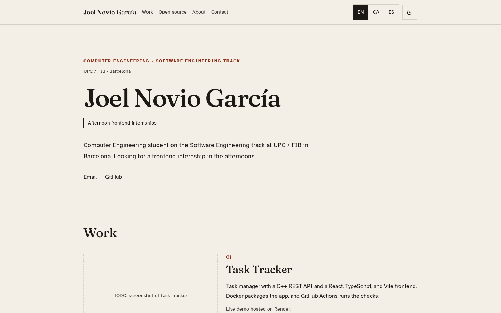
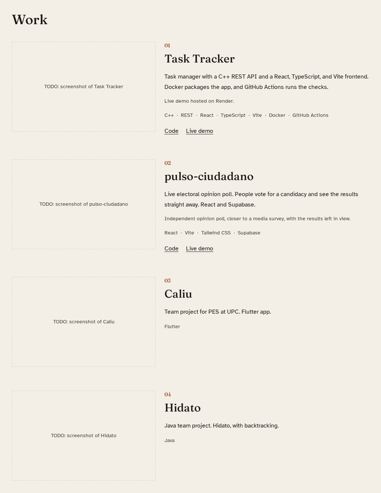
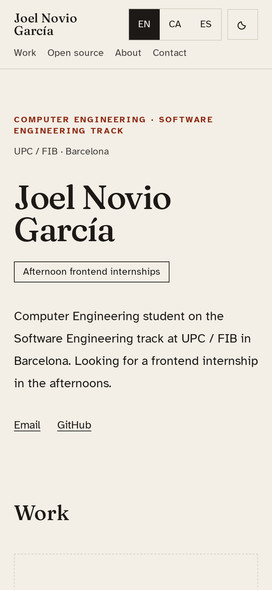

# Joel Novio García — Portfolio

[](https://react.dev/)
[](https://vite.dev/)
[](https://www.typescriptlang.org/)
[](https://tailwindcss.com/)
[](https://portfolio-sigma-roan-wlb4xykmfi.vercel.app/)

Personal portfolio of Joel Novio García, a Computer Engineering student (Software Engineering track) at UPC / FIB in Barcelona, focused on frontend development.

**Live site:** https://portfolio-sigma-roan-wlb4xykmfi.vercel.app/



## Screenshots

| Projects | Mobile |
| --- | --- |
|  |  |

## Features

- Single-page layout with sections for work, about and contact
- Three languages: English, Catalan and Spanish
- Light and dark theme
- Project cards with links to each repository and live demo
- Section navigation that highlights the section in view, plus a skip-to-content link
- Page title and Open Graph title update with the selected language
- Responsive design from mobile to wide desktop

## Featured projects

### Task Tracker
Task manager with a C++ REST API and a React + TypeScript + Vite frontend, packaged with Docker and checked with GitHub Actions.
- Code: https://github.com/joelng25/Task-Tracker
- Live demo (Render): https://task-tracker-web-4uqz.onrender.com

### pulso-ciudadano
Live electoral opinion poll: people vote for a candidacy and see the results straight away. Built with React, Vite, Tailwind CSS and Supabase.
- Code: https://github.com/joelng25/pulso-ciudadano
- Live demo: https://pulso-ciudadano-green.vercel.app/

## Stack

- [React 19](https://react.dev/) + [TypeScript](https://www.typescriptlang.org/)
- [Vite 7](https://vite.dev/) with `@vitejs/plugin-react`
- [Tailwind CSS 4](https://tailwindcss.com/) via `@tailwindcss/vite`
- Fonts: Fraunces and Atkinson Hyperlegible (`@fontsource`)
- Hosting: [Vercel](https://vercel.com/)

## Project structure

```
├── docs/
│   └── screenshots/         # images used in this README
├── public/
│   └── favicon.svg
├── src/
│   ├── components/
│   │   ├── ExternalLink.tsx
│   │   └── ScreenshotSlot.tsx
│   ├── App.tsx              # page layout and sections
│   ├── content.ts           # all texts and projects (EN/CA/ES)
│   ├── index.css
│   ├── main.tsx
│   └── vite-env.d.ts
├── index.html
├── package.json
├── tsconfig.json
├── tsconfig.app.json
├── tsconfig.node.json
├── vercel.json
└── vite.config.ts
```

## Scripts

| Command | Description |
| --- | --- |
| `npm run dev` | Start the dev server at http://localhost:5173 |
| `npm run build` | Type-check (`tsc -b`) and build for production into `dist/` |
| `npm run preview` | Serve the production build locally |

## Local setup

Requires Node.js 20.19+ (needed by Vite 7) and npm.

```bash
git clone https://github.com/joelng25/portfolio.git
cd portfolio
npm install
npm run dev
```

All texts and project data live in `src/content.ts`, so content changes don't require touching the layout.

## Deploy

The site is deployed on Vercel from the `main` branch. Every push to `main` triggers a production deploy; pull requests get preview deployments.

To deploy your own copy, import the repository in Vercel with the **Vite** preset. No environment variables are needed. `vercel.json` sets the build command (`npm run build`), the output directory (`dist`) and security headers.

## Contact

- Email: [joelnogao625@gmail.com](mailto:joelnogao625@gmail.com)
- GitHub: [github.com/joelng25](https://github.com/joelng25)
- LinkedIn: [linkedin.com/in/joel-novio](https://www.linkedin.com/in/joel-novio)
